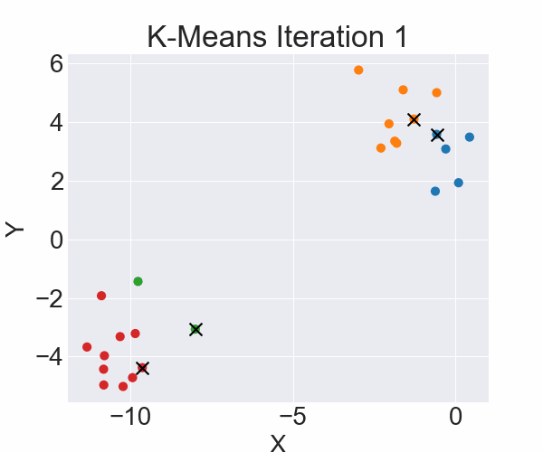
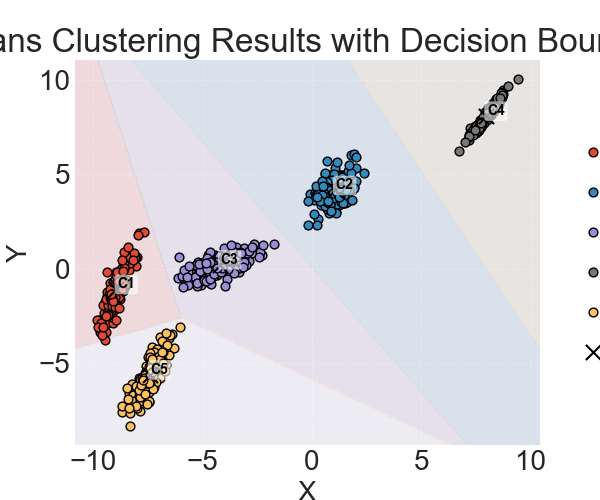
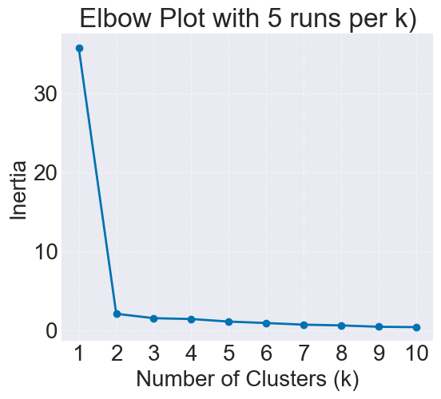
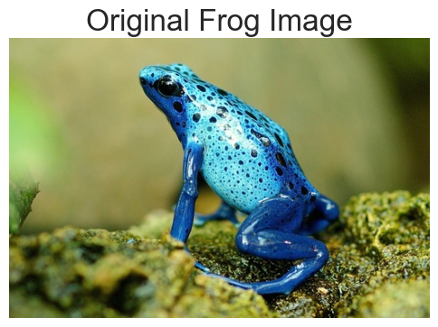
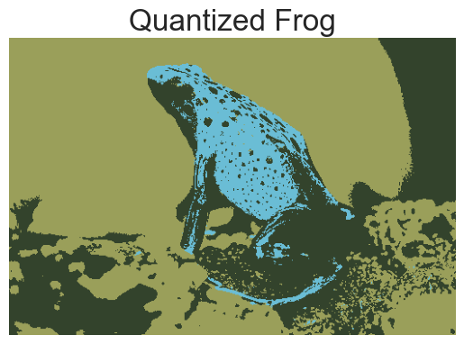

# K-Means Clustering, Visualized

K-means implemented from scratch in NumPy, used for customer segmentation and image color quantization, with an animation that shows the algorithm converging one iteration at a time.



## What's inside

| File | What it shows |
|---|---|
| [`kmeans.ipynb`](kmeans.ipynb) | Building and testing K-means, choosing *k* with elbow plots, how stable results are across random restarts, and best-of-N batch clustering |
| [`image_segmentation.ipynb`](image_segmentation.ipynb) | Color quantization: reducing a photo to a handful of colors by clustering its RGB pixels |
| `kmeans.py` | The `KMeans` class: initialization, label/centroid updates, inertia, `cluster_batch`, elbow plots |
| `kmeans_extension.py` | **Independent extension:** records centroid and label history at every iteration to drive the animation |

## Highlights

### Watching the algorithm learn (extension)
Static plots only show where K-means ends up. To show *how* it gets there, I added `run_with_history()` to save every iteration's state and replayed it with `matplotlib.animation.FuncAnimation`. Things I worked through along the way:
- Frames rendered out of order until each iteration's state was stored explicitly.
- Voronoi-style background shading, made by labeling every point of a `meshgrid` with its nearest centroid.
- Separate palettes for cluster points and centroids, so the centroids stay easy to track as they move.

The notebook also applies this to the **Mall Customers** dataset (Age vs Spending Score) to segment shoppers.

### Picking *k* and dealing with random restarts
| Clustered `cluster5` data | Elbow plot (best of N runs) |
|---|---|
|  |  |

A single K-means run can land in a poor local minimum, which makes single-run elbow plots noisy. Running `cluster_batch` and keeping the lowest-inertia result made the elbow consistent from run to run.

### Image quantization
| Original | 3-color quantization |
|---|---|
|  |  |

My first quantized images came out as a single flat color. The cause was un-normalized RGB values throwing off the distance calculations, and normalizing the pixels before clustering fixed it.

## Run it

```bash
pip install -r requirements.txt
jupyter lab
```

> The "image of your choice" cell in `image_segmentation.ipynb` loads a file that isn't included in this repo. Point it at any image of your own.

---
*Built for CS 251: Data Analysis and Visualization (Fall 2025). The course provided the project outline and test cells; the implementations, analysis, and the animation extension are my own work.*
